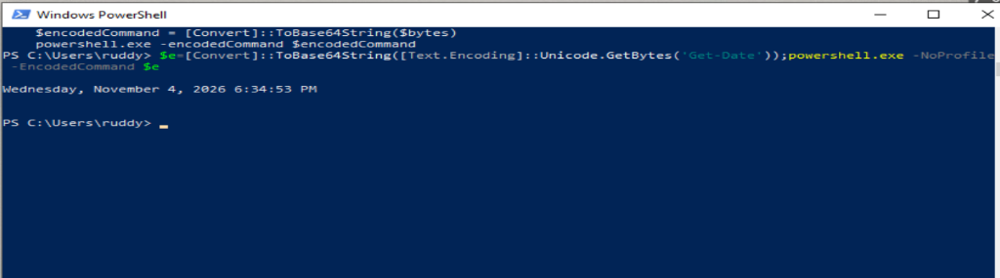
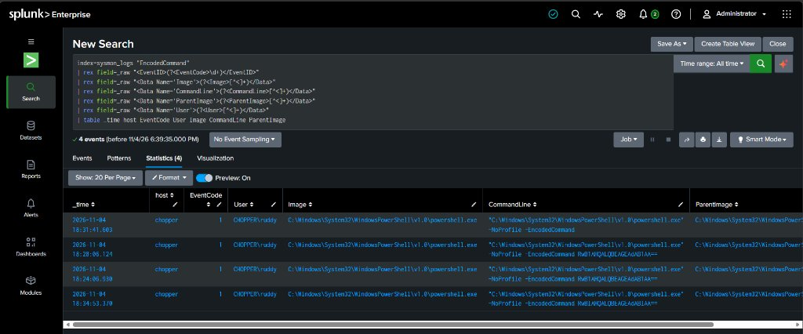
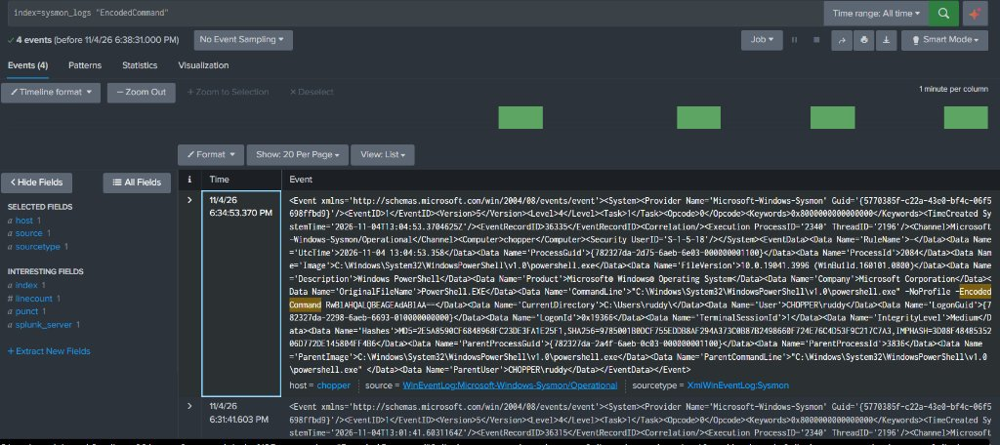

# TC-001: Encoded PowerShell Execution Detection

## A. Test Case Overview

| Attribute | Specification |
|---|---|
| **Test Case ID** | `TC-001` |
| **Test Case Name** | Encoded PowerShell Execution Detection |
| **Category** | Execution / Defense Evasion |
| **Objective** | Simulate harmless Base64-encoded PowerShell execution on the Windows 10 victim endpoint (`chopper`), verify Sysmon Event ID 1 collection, and validate detection through Splunk. |
| **MITRE ATT&CK Technique** | [T1059.001 - Command and Scripting Interpreter: PowerShell](https://attack.mitre.org/techniques/T1059/001/) |
| **Sub-Technique / Tactic** | Execution (`TA0002`), Defense Evasion (`TA0005` - Obfuscated Files: `T1027`) |
| **Severity Assessment** | Medium (Telemetry severity) / Low (Current lab impact) |
| **Affected Host** | `chopper` (Windows 10 x64) |
| **Executing User** | `CHOPPER\ruddy` |
| **Execution Timestamp** | 2026-11-04 18:34:53 (Latest Successful Execution) |
| **Investigation Status** | **`INVESTIGATED`** (Detection Validated • Investigation Active) |

---

## B. Lab Environment

* **Attacker / Operator Node**: Local interactive operator session on victim endpoint.
* **Victim Machine**: `chopper` (Windows 10 Enterprise x64).
* **SIEM Platform**: Splunk Enterprise 10.6.1.1 on Windows 11 host.
* **Log Forwarder**: Splunk Universal Forwarder running as a service on `chopper`.
* **Telemetry Source**: Microsoft Sysmon v15.x (`Microsoft-Windows-Sysmon/Operational`).
* **Ingestion Splunk Index**: `sysmon_logs`.
* **Sourcetype**: `XmlWinEventLog:Sysmon`.

---

## C. Attack Simulation

### Attack Scenario
Adversaries frequently utilize the `-EncodedCommand` parameter within `powershell.exe` to execute Unicode/Base64-encoded commands. This technique masks intent, circumvents simple string filters in proxy/EDR sensors, and prevents casual observation in process listings.

### Executed Command Line
Executed interactively in PowerShell on `chopper` by user `CHOPPER\ruddy`:

```powershell
$e=[Convert]::ToBase64String([Text.Encoding]::Unicode.GetBytes('Get-Date'));powershell.exe -NoProfile -EncodedCommand $e
```

### Decoded Payload Verification
* **Encoded Payload**: `RwBlAHQALQBEAGEAdABlAA==`
* **Encoding Type**: UTF-16LE Base64
* **Decoded Command**: `Get-Date`
* **Endpoint Console Output**: `Wednesday, November 4, 2026 6:34:53 PM`

```text
┌─────────────────────────────────────────────────────────────┐
│ Windows PowerShell Console (chopper)                        │
├─────────────────────────────────────────────────────────────┤
│ PS C:\Users\ruddy> $e=[Convert]::ToBase64String(            │
│   [Text.Encoding]::Unicode.GetBytes('Get-Date'));           │
│   powershell.exe -NoProfile -EncodedCommand $e              │
│                                                             │
│ Wednesday, November 4, 2026 6:34:53 PM                      │
│ PS C:\Users\ruddy>                                          │
└─────────────────────────────────────────────────────────────┘
```

### Telemetry Timeline & Run Progression
A total of **4 matching Sysmon Event ID 1 events** were captured in Splunk, revealing the operator's command testing sequence:

| # | Recorded Timestamp | Host | Executing User | Image | Command Line Parameters | Execution Analysis |
|---|---|---|---|---|---|---|
| **1** | `2026-11-04 18:24:06.930` | `chopper` | `CHOPPER\ruddy` | `powershell.exe` | `-NoProfile -EncodedCommand RwBlAHQALQBEAGEAdABlAA==` | Initial test execution |
| **2** | `2026-11-04 18:28:06.124` | `chopper` | `CHOPPER\ruddy` | `powershell.exe` | `-NoProfile -EncodedCommand RwBlAHQALQBEAGEAdABlAA==` | Repeat validation run |
| **3** | `2026-11-04 18:31:41.603` | `chopper` | `CHOPPER\ruddy` | `powershell.exe` | `-NoProfile -EncodedCommand` | Execution attempt without trailing payload |
| **4** | `2026-11-04 18:34:53.370` | `chopper` | `CHOPPER\ruddy` | `powershell.exe` | `-NoProfile -EncodedCommand RwBlAHQALQBEAGEAdABlAA==` | **Latest confirmed execution (Output verified)** |

---

## D. Log Collection & Telemetry

### Validated Sysmon Event Record (Event ID 1)

Raw XML event attributes captured from `index=sysmon_logs`:

```xml
<Event xmlns='http://schemas.microsoft.com/win/2004/08/events/event'>
  <System>
    <Provider Name='Microsoft-Windows-Sysmon' Guid='{5770385f-c22a-43e0-bf4c-06f5698ffbd9}'/>
    <EventID>1</EventID>
    <Version>5</Version>
    <Level>4</Level>
    <Task>1</Task>
    <Opcode>0</Opcode>
    <Keywords>0x8000000000000000</Keywords>
    <TimeCreated SystemTime='2026-11-04T13:04:53.3704625Z'/>
    <EventRecordID>36335</EventRecordID>
    <Channel>Microsoft-Windows-Sysmon/Operational</Channel>
    <Computer>chopper</Computer>
    <Security UserID='S-1-5-18'/>
  </System>
  <EventData>
    <Data Name='RuleName'>-</Data>
    <Data Name='UtcTime'>2026-11-04 13:04:53.358</Data>
    <Data Name='ProcessGuid'>{782327da-2d75-6aeb-6e03-000000001100}</Data>
    <Data Name='ProcessId'>2084</Data>
    <Data Name='Image'>C:\Windows\System32\WindowsPowerShell\v1.0\powershell.exe</Data>
    <Data Name='FileVersion'>10.0.19041.3996 (WinBuild.160101.0800)</Data>
    <Data Name='Description'>Windows PowerShell</Data>
    <Data Name='Product'>Microsoft® Windows® Operating System</Data>
    <Data Name='Company'>Microsoft Corporation</Data>
    <Data Name='OriginalFileName'>PowerShell.EXE</Data>
    <Data Name='CommandLine'>"C:\Windows\System32\WindowsPowerShell\v1.0\powershell.exe" -NoProfile -EncodedCommand RwBlAHQALQBEAGEAdABlAA==</Data>
    <Data Name='CurrentDirectory'>C:\Users\ruddy\</Data>
    <Data Name='User'>CHOPPER\ruddy</Data>
    <Data Name='IntegrityLevel'>Medium</Data>
    <Data Name='Hashes'>MD5=2E5A8590CF6848968FC23DE3FA1E25F1,SHA256=9785001B00CF755EDDB8AF294A373C0B87B2498660F724E76C4D53F9C217C7A3,IMPHASH=3D08F4848535206D772DE145804FF4B6</Data>
    <Data Name='ParentProcessGuid'>{782327da-2a4f-6aeb-0c03-000000001100}</Data>
    <Data Name='ParentProcessId'>3836</Data>
    <Data Name='ParentImage'>C:\Windows\System32\WindowsPowerShell\v1.0\powershell.exe</Data>
    <Data Name='ParentCommandLine'>"C:\Windows\System32\WindowsPowerShell\v1.0\powershell.exe"</Data>
    <Data Name='ParentUser'>CHOPPER\ruddy</Data>
  </EventData>
</Event>
```

---

## E. Splunk Detection & Queries

### 1. Primary Operational Query (As Tested)

Because Sysmon logs are ingested in raw XML structure (`XmlWinEventLog:Sysmon`), regular expression extraction cleanly surfaces nested XML data nodes into structured search columns:

```spl
index=sysmon_logs "EncodedCommand"
| rex field=_raw "<EventID>(?<EventCode>\d+)</EventID>"
| rex field=_raw "<Data Name='Image'>(?<Image>[^<]+)</Data>"
| rex field=_raw "<Data Name='CommandLine'>(?<CommandLine>[^<]+)</Data>"
| rex field=_raw "<Data Name='ParentImage'>(?<ParentImage>[^<]+)</Data>"
| rex field=_raw "<Data Name='User'>(?<User>[^<]+)</Data>"
| table _time host EventCode User Image CommandLine ParentImage
```

* **Query Logic**:
  * Scans `index=sysmon_logs` for occurrences of the string `EncodedCommand`.
  * Extracts the core process creation fields from `<Data Name='...'>` XML elements.
  * Formats output into an interactive table ordered chronologically.
* **Results**: **4 matching events returned** from host `chopper`.

### 2. Enhanced Enterprise Production Variant

To catch case-insensitive variants, parameter truncations (`-enc`, `-e`, `-encodedcommand`), and extract the payload string directly for SOC decode automation:

```spl
index=sysmon_logs EventCode=1 (Image="*\\powershell.exe" OR OriginalFileName="PowerShell.EXE")
| rex field=_raw "<Data Name='CommandLine'>(?<CommandLine>[^<]+)</Data>"
| regex CommandLine="(?i)-(?:e|en|enc|encodedcommand)\s+(?<EncodedPayload>[A-Za-z0-9+/=]{8,})"
| table _time, host, User, CommandLine, EncodedPayload, ParentImage
```

---

## F. Investigation & Forensic Analysis

```text
┌─────────────────────────────────────────────────────────────┐
│                     PROCESS LINEAGE TREE                    │
├─────────────────────────────────────────────────────────────┤
│ [PID 3836] C:\Windows\System32\...\powershell.exe (Parent)  │
│   │                                                         │
│   └──► [PID 2084] powershell.exe -NoProfile                 │
│                   -EncodedCommand RwBlAHQALQBEAGEAdABlAA==  │
│                   (Child / Decoded: Get-Date)               │
└─────────────────────────────────────────────────────────────┘
```

1. **User Identity Context**: Executed under local interactive account `CHOPPER\ruddy` at `Medium` integrity level. No privilege escalation was detected or attempted.
2. **Parent Process Analysis**: The spawning process was an interactive parent PowerShell console (`ParentProcessId: 3836`, `ParentImage: powershell.exe`). This confirms interactive command execution from a user session rather than an automated task, service, or remote shell hook.
3. **Payload Intent Analysis**:
   * Base64 string `RwBlAHQALQBEAGEAdABlAA==` translates via UTF-16LE to `Get-Date`.
   * The command solely queries local endpoint system time.
   * No outbound network sockets (`Sysmon Event ID 3`) or file creations (`Event ID 11`) were triggered by this process.

---

## G. SOC Analyst Assessment

* **Event Classification**: **Benign Positive (Authorized Simulation)**
* **Investigation Confidence**: High (100% verified via endpoint console output and raw XML telemetry).
* **Threat Score**: Low (Lab testing context). If observed on an unapproved production workstation outside change control, this pattern warrants P3 (Medium) severity triage.
* **Investigation Status**: **`INVESTIGATED`** (Field telemetry validated; case remains open pending final closure reviews).

---

## H. Incident Response & Recommendations

### Production Response Guidance (If Malicious)
1. **Containment**: Isolate target workstation from the corporate VLAN if the decoded Base64 payload reveals C2 network communication, memory injection, or credential harvesting.
2. **ScriptBlock Analysis**: Review Event ID 4104 (`Microsoft-Windows-PowerShell/Operational`) on `chopper` to audit full script blocks executed during the session.
3. **Hardening**:
   * Enforce PowerShell Constrained Language Mode (CLM) across non-privileged user profiles.
   * Enable AppLocker / Windows Defender Application Control (WDAC) to restrict arbitrary script execution.

---

## I. Evidence Inventory

All supporting screenshots and forensic captures are preserved in [`14-Evidence/Splunk-Screenshots/TC-001/`](../../14-Evidence/Splunk-Screenshots/TC-001/):

| Evidence ID | Description | File Reference |
|---|---|---|
| **EVD-TC001-01** | Endpoint PowerShell console execution on `chopper` with `Get-Date` output | [`TC001-Endpoint-Execution.png`](../../14-Evidence/Splunk-Screenshots/TC-001/TC001-Endpoint-Execution.png) |
| **EVD-TC001-02** | Splunk search statistics table showing all 4 captured process creation events | [`TC001-Splunk-Statistics-Table.jpg`](../../14-Evidence/Splunk-Screenshots/TC-001/TC001-Splunk-Statistics-Table.jpg) |
| **EVD-TC001-03** | Splunk raw XML event inspector showing full Sysmon Event ID 1 attributes | [`TC001-Splunk-Raw-Event.jpg`](../../14-Evidence/Splunk-Screenshots/TC-001/TC001-Splunk-Raw-Event.jpg) |

### Evidence Visuals

#### 1. Endpoint Console Execution


#### 2. Splunk Statistics Table (4 Events Captured)


#### 3. Splunk Raw Event XML Inspection


---

## J. Conclusion & Current Milestone

* **Summary**: Harmless Base64-encoded execution (`Get-Date`) was executed on `chopper`. Sysmon Event ID 1 instrumentation successfully captured process creation with full command lines, and Splunk forwarded and indexed all events in `sysmon_logs`.
* **Detection Validation**: **SUCCESSFUL**
* **Milestone Status**: **`INVESTIGATED`** (Preserved as active evidence-backed test case).
